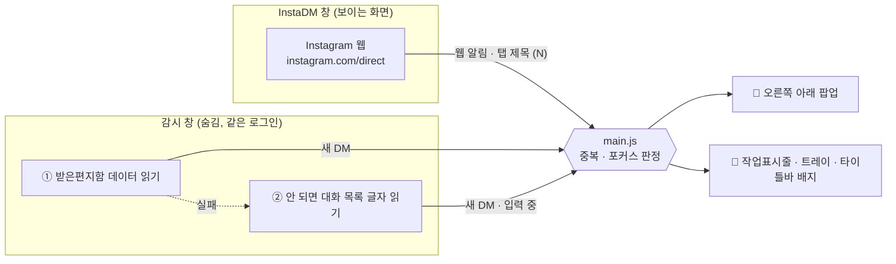

<div align="center">


# InstaDM

**카카오톡처럼 쓰는 Instagram DM 데스크톱 앱**

창을 닫아도 트레이에서 기다리다가, 새 DM이 오면 화면 오른쪽 아래에 팝업을 띄웁니다.


</div>

---

## 왜 만들었나

Instagram DM은 브라우저 탭을 열어 두지 않으면 놓치기 쉽고, 휴대폰 알림은 PC 앞에서 일할 때 손이 한 번 더 갑니다.
InstaDM은 **메신저처럼 항상 켜 두는 DM 창**입니다. 공식 Instagram 웹을 그대로 띄우기 때문에 쓰는 방법은 똑같고, 알림만 카카오톡처럼 받습니다.

## 한눈에 보기

| | 기능 | 설명 |
|---|---|---|
| 💬 | **오른쪽 아래 팝업** | 보낸 사람, 프로필 사진, 메시지 미리보기. 누르면 그 대화가 바로 열립니다. 최대 4개까지 쌓이고 5초 뒤 사라집니다. |
| ✍️ | **입력 중 알림** | 상대가 입력을 시작하면 "입력 중" 팝업이 뜨고, 메시지를 보내면 그 내용으로 바뀝니다. |
| 🔕 | **DM만 알림** | 좋아요, 팔로우 같은 활동 알림이나 이미 읽은 메시지는 알리지 않습니다. 창을 보고 있을 때도 띄우지 않습니다. |
| 🔴 | **읽지 않음 표시** | 작업표시줄 빨간 점, 트레이 툴팁, 타이틀바 배지에 읽지 않은 DM 수를 보여 줍니다. |
| 🪟 | **트레이 상주** | X를 눌러도 꺼지지 않고 트레이로 숨습니다. Windows 시작 시 자동 실행도 됩니다. |
| 🎨 | **커스텀 타이틀바** | Instagram 다크·라이트 모드에 맞춰 색이 바뀌고, 읽지 않은 DM이 있으면 경계선이 그라데이션으로 빛납니다. |
| 👆 | **목록 사진 클릭 = 대화 열기** | 받은편지함에서 프로필 사진을 눌러도 스토리 대신 대화가 열립니다. |
| 🔐 | **비밀번호 저장 안 함** | 창 안에서 Instagram에 직접 로그인합니다. 로그인 상태만 앱 세션에 남습니다. |

## 설치

### 설치 파일로

1. `npm run dist`로 만든 `dist/InstaDM-Setup-1.0.4.exe`를 실행합니다.
2. 설치 위치를 고르고 설치하면 바탕화면과 시작 메뉴에 **InstaDM** 바로가기가 생깁니다.
3. 처음 실행하면 창에서 Instagram에 로그인합니다. 끝입니다.

### 소스에서 바로 실행

```bash
npm install
npm start
```

| 명령 | 하는 일 |
|---|---|
| `npm start` | 앱 실행 |
| `npm run test-popup` | 로그인 없이 알림 팝업 모양만 확인 |
| `npm run dist` | 설치 파일(NSIS) 만들기 → `dist/` |
| `npm run dist:portable` | 설치 없이 실행하는 portable .exe 만들기 |

> [!TIP]
> VS Code 터미널에서 `Cannot read properties of undefined (reading 'userAgentFallback')`가 나오면 `ELECTRON_RUN_AS_NODE` 환경 변수를 지우고 다시 실행하세요.
> 이미 실행 중이면 새로 띄운 앱은 바로 꺼지고 기존 창이 앞으로 나옵니다. 코드를 고쳤다면 **트레이 → 종료** 후 다시 실행하세요.

## 어떻게 동작하나



1. **같은 로그인 세션을 쓰는 숨은 감시 창**이 받은편지함을 항상 열어 둡니다. 보이는 창에서 무엇을 하든 알림은 따로 돌아갑니다.
2. 감시 창은 Instagram 웹이 쓰는 받은편지함 데이터를 읽어 보낸 사람·내용·프로필 사진을 알아냅니다. 이게 막히면 화면의 대화 목록에서 **굵은 글씨(읽지 않음)** 줄과 "입력 중" 표시를 읽습니다.
3. 대화마다 마지막으로 알린 상태를 기억해, **바뀌었을 때만** 팝업을 띄웁니다. 같은 메시지가 두 번 뜨거나 읽은 메시지가 다시 뜨지 않습니다.
4. 절전에서 깨어나거나 잠금을 풀면 감시 창을 다시 불러와 알림이 멈추지 않게 합니다.

> [!NOTE]
> **계정 보호를 위해 요청을 아낍니다.** 데이터는 읽지 않음 숫자가 오를 때와 1분마다만 요청하고, Instagram이 401/403/429로 답하면 10분 동안 멈춥니다.

자세한 판정 규칙은 [알림 구현 원리](docs/[02]%20알림%20구현%20원리.md)에 있습니다.

## 메뉴

트레이 아이콘 우클릭, 또는 타이틀바의 **⋯** 버튼에서 같은 메뉴를 엽니다.

| 메뉴 | 설명 |
|---|---|
| 알림 받기 / 알림 소리 / 메시지 미리보기 | 끄고 켤 수 있습니다. 미리보기를 끄면 내용 대신 "새 메시지가 도착했습니다."가 나옵니다. |
| Windows 시작 시 실행 | 로그인하면 트레이로 조용히 시작합니다. |
| 보기 → 확대 · 축소 · 원래 크기 | Instagram 화면 배율 |
| 알림 테스트 | 팝업이 제대로 뜨는지 확인 |
| 새로고침 | 보이는 창과 감시 창을 모두 다시 불러오기 |
| 알림 경로 점검 | 데이터 읽기 · 화면 읽기 · 프로필 사진이 되는지 결과만 보여 줌 (메시지 내용은 안 보여 줌) |
| 감시 창 보기 | 숨은 감시 창을 잠깐 꺼내 보기 |
| 로그 파일 열기 | `%APPDATA%\insta-dm\insta-dm.log` |
| 문제 진단 파일 저장 | 대화 목록의 구조(태그, 글자 수)만 바탕화면에 저장 |
| 버전 | 설치된 버전 표시 (트레이 툴팁에도 나옴) |

### 단축키

| 키 | 동작 |
|---|---|
| `Ctrl` + `R` | 새로고침 |
| `Ctrl` + `=` / `-` / `0` | 확대 / 축소 / 원래 크기 |
| `Ctrl` + `Shift` + `I` | 개발자 도구 |

## 개인정보

- 비밀번호를 저장하지 않습니다. 로그인은 Instagram 공식 화면에서 직접 합니다.
- 메시지는 내 PC 안에서만 읽고, 어디로도 보내지 않습니다.
- 로그와 진단 파일에는 **메시지 내용, 이름, 프로필 주소를 남기지 않습니다.** 상태와 개수, 경로만 남깁니다.
- 앱을 지워도 로그인 정보(`%APPDATA%\insta-dm`)는 남습니다. 완전히 지우려면 이 폴더도 지우세요.

## 문제 해결

<details>
<summary><b>팝업이 안 떠요</b></summary>

1. 메인 창을 보고 있으면 팝업을 띄우지 않습니다. 창을 숨기거나 다른 창을 앞에 둔 채로 확인하세요.
2. 메뉴에서 **알림 받기**가 켜져 있는지, **알림 테스트**로 팝업이 뜨는지 봅니다.
3. **알림 경로 점검**으로 감시 창이 받은편지함을 읽고 있는지 확인합니다.
4. **로그 파일 열기**에서 `팝업 생략` 줄이 있으면 그 이유(`off`, `focus`, `dup`)를 봅니다.
</details>

<details>
<summary><b>창이 하얗게만 보여요</b></summary>

`Ctrl` + `R`로 새로고침하거나 창 크기를 한 번 바꿔 보세요. 그래도 안 되면 트레이 → 종료 후 다시 실행합니다.
</details>

<details>
<summary><b>로그인이 안 돼요</b></summary>

페이스북·Meta 로그인은 앱 안의 작은 창에서 진행됩니다. 그래도 막히면 Instagram의 새 기기 보안 확인 때문일 수 있으니, 휴대폰 앱에서 로그인 시도를 승인한 뒤 다시 해 보세요.
</details>

<details>
<summary><b>같은 메시지를 연달아 보내면 두 번째가 안 떠요</b></summary>

알려진 한계입니다. 화면 읽기는 미리보기 글자가 바뀌었는지로 새 메시지를 알아보기 때문에, 똑같은 글자가 연달아 오면 구분하지 못합니다.
</details>

## 한계

- 공개 API가 아니라 **Instagram 웹 내부 구조**에 기대고 있습니다. Instagram이 화면이나 경로를 바꾸면 알림이 달라질 수 있습니다.
- 지금은 받은편지함 데이터 경로가 404를 돌려줘서 **화면 읽기로만** 알립니다. 이 때문에 배지 숫자에 좋아요 같은 다른 알림이 섞일 수 있습니다.
- 감시 창이 멈춰 있던 사이(절전 중 등)에 온 메시지는 따로 알리지 않습니다.
- 최대화 버튼에 마우스를 올려도 Windows 11 스냅 레이아웃이 나오지 않습니다(`Win` + `Z`, 끌어서 스냅은 됩니다).
- Windows 전용입니다.

## 문서

| 문서 | 내용 |
|---|---|
| [기술과 원리](docs/[03]%20기술과%20원리.md) | 무엇으로 만들었고 각 기능이 어떻게 동작하는지. **처음이라면 여기부터** |
| [구조](docs/[00]%20구조.md) | 파일, 창 구성, 알림 흐름, IPC 채널 |
| [알림 구현 원리](docs/[02]%20알림%20구현%20원리.md) | 새 DM 감지 규칙, 입력 중 처리, 한계 |
| [업데이트 내역](docs/[01]%20업데이트%20내역.md) | 날짜별 증상 · 원인 · 수정 · 남은 문제 |
| [AGENTS.md](AGENTS.md) | 코드를 고칠 때 지킬 규칙 |

---

<div align="center">
<sub>Instagram과 Meta의 공식 앱이 아닙니다. Instagram은 Meta Platforms, Inc.의 상표입니다.</sub>
</div>
